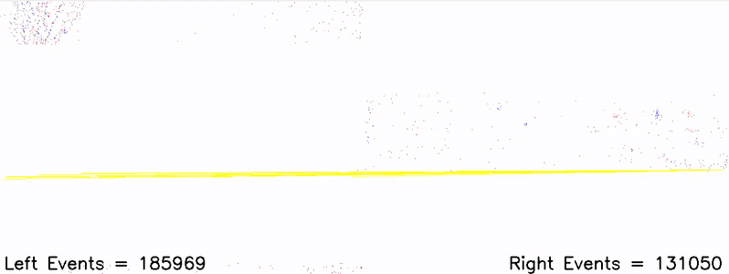
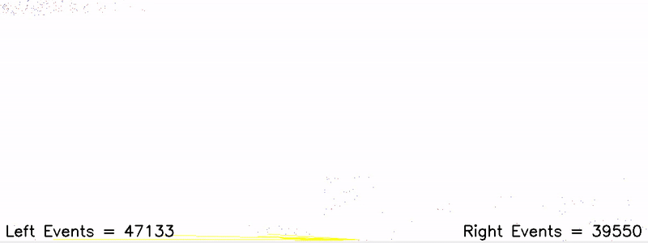
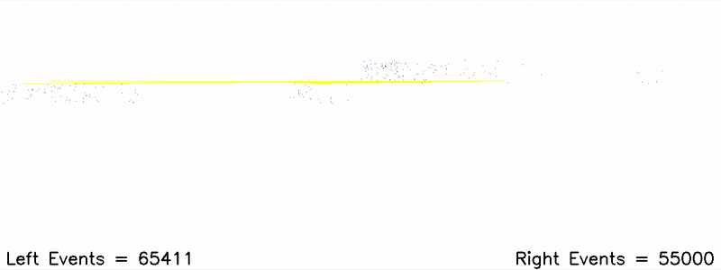

# Stereo Events GNN Dev
Python model that use GNNs to compute depth from stereo event data. 

# Set Up the Environment
```
python3.12 -m venv ./venv_3_12
```
```
source venv_3_12/bin/activate
```
```
pip install -r requirements.txt
```

# Graph Creation Demo
Download DSEC events data from [here](https://download.ifi.uzh.ch/rpg/DSEC/train_coarse/train_events.zip).


Adjust the dsec sequence path in the ```pictorial_stereo_event_graph_creation.py```

Run:
```
python pictorial_stereo_event_graph_creation.py
```
Results with ```1000 us``` event set lenght and ```10``` neighboards.

It's that big just for seeing something that makes sense to human but it will probably be something around 10s of us.




Results with ```20 us``` event set lenght and ```10``` neighboards.



A big issue came out from the dataset creation: it seems like if the events are not completelly taken asynchronously,
as wee can see also in the 1000 us gif seems like if there is a vertical update. From the following it seams to be something around 80 us but it's probably dependent on the number of events. This isse set the minimum even set lenght limit if we want to use DSEC.

